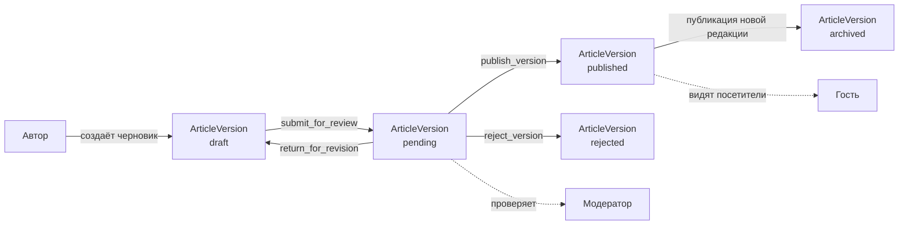
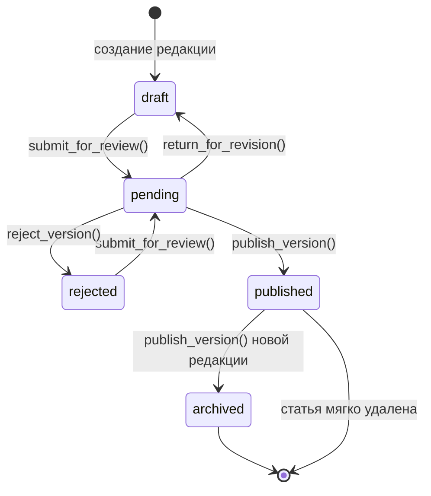
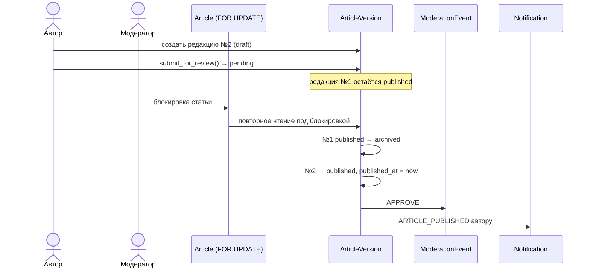
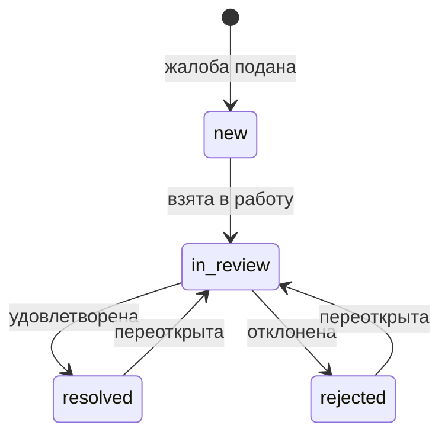
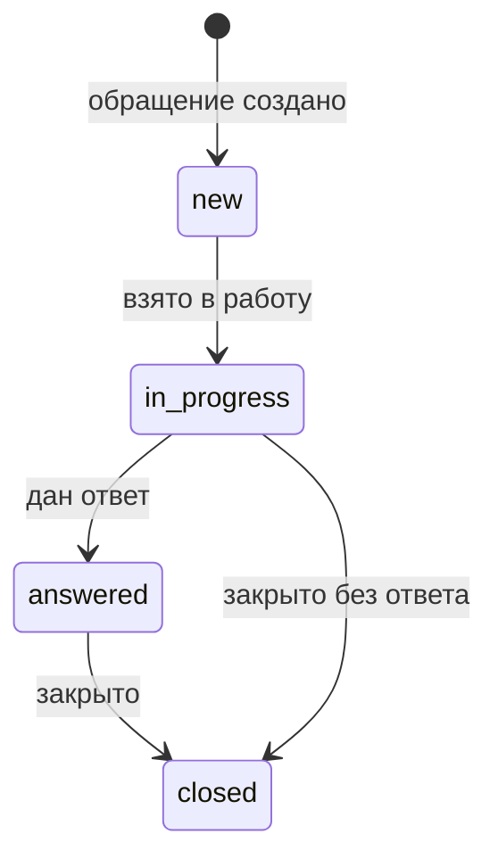

# Схема базы данных FIPLPEOPLE.RU

Документ описывает структуру базы данных платформы **FIPLPEOPLE.RU** — сайта базы
знаний и студенческого сообщества направления «Фундаментальная и прикладная
лингвистика» НГУ.

| Параметр | Значение |
|---|---|
| Целевая СУБД | PostgreSQL 16 (проверено на 16.9) |
| Резервная СУБД для тестов | SQLite (частичные индексы и CHECK-ограничения поддерживаются) |
| Серверный фреймворк | Django 5.2 LTS |
| Приложений | 5 (`accounts`, `catalog`, `content`, `moderation`, `notifications`) |
| Прикладных моделей | 17 |
| Диаграммы | `docs/diagrams/*.mmd` (Mermaid ER) |

Оглавление:

1. [Общая архитектура базы данных](#1-общая-архитектура-базы-данных)
2. [Состав базы данных](#2-состав-базы-данных)
3. [Таблицы и поля](#3-таблицы-и-поля)
4. [Связи между сущностями](#4-связи-между-сущностями)
5. [Ограничения целостности](#5-ограничения-целостности)
6. [Индексы](#6-индексы)
7. [Механизм версионирования статей](#7-механизм-версионирования-статей)
8. [Жизненный цикл модерации](#8-жизненный-цикл-модерации)
9. [Роли и разрешения](#9-роли-и-разрешения)
10. [Общая ER-диаграмма](#10-общая-er-диаграмма)
11. [Файлы и вложения](#11-файлы-и-вложения)
12. [Миграции и первоначальная инициализация](#12-миграции-и-первоначальная-инициализация)
13. [Принятые решения и известные ограничения](#13-принятые-решения-и-известные-ограничения)
14. [Что не реализовано](#14-что-не-реализовано)

---

## 1. Общая архитектура базы данных

Прикладная часть БД разделена по предметным областям и повторяет структуру
Django-приложений. Служебные таблицы фреймворка (`auth_*`, `django_*`,
промежуточные таблицы связей «многие ко многим») вынесены в отдельную
диаграмму [`system.mmd`](diagrams/system.mmd) и в основную схему не входят.

| Приложение | Назначение | Таблицы |
|---|---|---|
| `accounts` | учётные записи, внешние аккаунты, профили, ссылки профиля | `accounts_user`, `accounts_externalaccount`, `accounts_profile`, `accounts_profilelink` |
| `catalog` | учебный каталог: семестры, дисциплины, их связь, типы материалов | `catalog_semester`, `catalog_discipline`, `catalog_semesterdiscipline`, `catalog_materialtype` |
| `content` | учебные материалы, редакции, вложения, комментарии | `content_article`, `content_articleversion`, `content_fileattachment`, `content_comment` |
| `moderation` | история модерации, жалобы, обращения администрации | `moderation_moderationevent`, `moderation_report`, `moderation_feedbackmessage` |
| `notifications` | уведомления пользователей, журнал действий персонала | `notifications_notification`, `notifications_auditlog` |

### 1.1. Общие соглашения

| Решение | Значение |
|---|---|
| Первичные ключи | `bigint` (`BigAutoField`, `GENERATED BY DEFAULT AS IDENTITY`) во всех прикладных таблицах; служебные таблицы `auth_*` используют `integer` |
| Даты и время | `timestamptz`, хранение в UTC (`USE_TZ = True`), отображение в `Asia/Novosibirsk` |
| Именование таблиц | `<app>_<model>` в нижнем регистре |
| Удаление материалов | мягкое (`content_article.deleted_at`), физическое удаление статей в админке запрещено |
| Содержимое файлов | файловое хранилище; в БД — метаданные и путь |
| Роли | штатные `auth_group` / `auth_permission` Django |
| Пароли | для доменных пользователей не задаются (`set_unusable_password`) |
| Email | хранится в нижнем регистре, уникальность без учёта регистра |
| Статусы | домен статуса защищён и Python-перечислением, и CHECK-ограничением |

### 1.2. Поток данных



---

## 2. Состав базы данных

### 2.1. Прикладные таблицы

| # | Таблица | Модель | Назначение |
|---|---|---|---|
| 1 | `accounts_user` | `User` | Учётная запись участника (email как идентификатор) |
| 2 | `accounts_externalaccount` | `ExternalAccount` | Связь с провайдером авторизации (Google) |
| 3 | `accounts_profile` | `Profile` | Публичный профиль, один на пользователя |
| 4 | `accounts_profilelink` | `ProfileLink` | Ссылки профиля с индивидуальной видимостью |
| 5 | `catalog_semester` | `Semester` | Семестр |
| 6 | `catalog_discipline` | `Discipline` | Дисциплина, не привязанная к одному семестру |
| 7 | `catalog_semesterdiscipline` | `SemesterDiscipline` | Связь «семестр — дисциплина» |
| 8 | `catalog_materialtype` | `MaterialType` | Тип материала (лекции, семинары, ДЗ и др.) |
| 9 | `content_article` | `Article` | Учебный материал как сущность |
| 10 | `content_articleversion` | `ArticleVersion` | Редакция материала: содержание и статус модерации |
| 11 | `content_fileattachment` | `FileAttachment` | Файл редакции (PDF, DOCX, ZIP, DJVU и др.) |
| 12 | `content_comment` | `Comment` | Комментарий и ответы |
| 13 | `moderation_moderationevent` | `ModerationEvent` | История решений модераторов |
| 14 | `moderation_report` | `Report` | Жалоба на статью или комментарий |
| 15 | `moderation_feedbackmessage` | `FeedbackMessage` | Обращение к администрации |
| 16 | `notifications_notification` | `Notification` | Уведомление пользователя |
| 17 | `notifications_auditlog` | `AuditLog` | Журнал значимых действий персонала |

### 2.2. Служебные таблицы

`auth_group`, `auth_permission`, `auth_group_permissions`, `django_content_type`,
`django_admin_log`, `django_migrations`, `django_session`,
`accounts_user_groups`, `accounts_user_user_permissions`.

Схема служебных таблиц: [`diagrams/system.mmd`](diagrams/system.mmd).

---

## 3. Таблицы и поля

Обозначения: `PK` — первичный ключ, `FK` — внешний ключ, `U` — уникальное
значение, `null` — допускается `NULL`.

### 3.1. `accounts_user` — пользователи

| Поле | Тип | Ограничения | Описание |
|---|---|---|---|
| `id` | bigint | PK | Идентификатор |
| `email` | varchar(254) | U, U(lower) | Логин; хранится в нижнем регистре |
| `password` | varchar(128) | | Хеш Django; у доменных пользователей непригоден (`!…`) |
| `is_active` | boolean | | Активность; снятие флага = блокировка |
| `is_staff` | boolean | | Доступ в административную панель |
| `is_superuser` | boolean | | Все права без явного назначения |
| `first_name`, `last_name` | varchar(150) | | Служебные поля персонала |
| `date_joined` | timestamptz | | Дата регистрации |
| `last_login` | timestamptz | null | Дата последнего входа |
| `groups` | M2M → `auth_group` | | Роли USER / MODERATOR / ADMIN |
| `user_permissions` | M2M → `auth_permission` | | Индивидуальные разрешения |

Нормализация email выполняется в `UserManager`, `User.clean()` и `User.save()`
функцией `normalize_email_address()`; уникальность без учёта регистра
гарантирует индекс `lower(email)`.

### 3.2. `accounts_externalaccount` — внешние аккаунты

| Поле | Тип | Ограничения | Описание |
|---|---|---|---|
| `id` | bigint | PK | |
| `user_id` | bigint | FK → `accounts_user`, CASCADE | Локальный пользователь |
| `provider` | varchar(32) | CHECK-список | Провайдер: `google` |
| `provider_uid` | varchar(255) | U с `provider` | Идентификатор `sub` у провайдера |
| `email_verified` | boolean | | Признак подтверждённого email |
| `created_at`, `updated_at` | timestamptz | | Метки времени |

OAuth-токены и секреты не хранятся.

### 3.3. `accounts_profile` — профили

| Поле | Тип | Ограничения | Описание |
|---|---|---|---|
| `id` | bigint | PK | |
| `user_id` | bigint | FK → `accounts_user`, CASCADE, **U** | Один профиль на пользователя |
| `display_name` | varchar(150) | | Имя для других участников |
| `bio` | text | | Описание «о себе» |
| `avatar` | varchar(255) | | Путь к изображению |
| `is_public` | boolean | | Показывать в разделе «Люди» |
| `created_at`, `updated_at` | timestamptz | | Метки времени |

### 3.4. `accounts_profilelink` — ссылки профиля

| Поле | Тип | Ограничения | Описание |
|---|---|---|---|
| `id` | bigint | PK | |
| `profile_id` | bigint | FK → `accounts_profile`, CASCADE | Профиль |
| `title` | varchar(150) | | Подпись |
| `url` | varchar(500) | | Адрес |
| `is_public` | boolean | | Видимость ссылки |

### 3.5. `catalog_semester` — семестры

| Поле | Тип | Ограничения | Описание |
|---|---|---|---|
| `id` | bigint | PK | |
| `number` | smallint | U, CHECK ≥ 1 | Номер семестра |
| `name` | varchar(100) | | Отображаемое название |
| `is_active` | boolean | | Скрытие из каталога |

### 3.6. `catalog_discipline` — дисциплины

| Поле | Тип | Ограничения | Описание |
|---|---|---|---|
| `id` | bigint | PK | |
| `name` | varchar(255) | | Название |
| `slug` | varchar(255) | U | Идентификатор в URL |
| `description` | text | | Аннотация |
| `is_active` | boolean | | Скрытие из каталога |

Регистронезависимая уникальность названий **не** реализуется ограничением БД:
поведение `LOWER()` зависит от локали кластера (в локали `C` кириллица не
понижается), поэтому уникальность обеспечивается полем `slug`, а проверка
дублей названий переносится в валидацию формы.

### 3.7. `catalog_semesterdiscipline` — дисциплины семестров

| Поле | Тип | Ограничения | Описание |
|---|---|---|---|
| `id` | bigint | PK | |
| `semester_id` | bigint | FK → `catalog_semester`, PROTECT | Семестр |
| `discipline_id` | bigint | FK → `catalog_discipline`, PROTECT | Дисциплина |

Уникальность пары `(semester_id, discipline_id)`.

### 3.8. `catalog_materialtype` — типы материалов

| Поле | Тип | Ограничения | Описание |
|---|---|---|---|
| `id` | bigint | PK | |
| `name` | varchar(100) | U | Название |
| `slug` | varchar(63) | U | Идентификатор |
| `is_active` | boolean | | Доступность при публикации |

Начальный набор: Лекции, Семинары, Домашние задания, Коллоквиумы,
Экзаменационные билеты, Контрольные работы, Учебники, Дополнительная
литература, Прочее (миграция данных `catalog/0002`).

### 3.9. `content_article` — статьи

| Поле | Тип | Ограничения | Описание |
|---|---|---|---|
| `id` | bigint | PK | |
| `author_id` | bigint | FK → `accounts_user`, PROTECT | Автор |
| `created_at` | timestamptz | | Создана |
| `updated_at` | timestamptz | | Изменена (обновляется при публикации) |
| `deleted_at` | timestamptz | null | Мягкое удаление |

### 3.10. `content_articleversion` — редакции статей

| Поле | Тип | Ограничения | Описание |
|---|---|---|---|
| `id` | bigint | PK | |
| `article_id` | bigint | FK → `content_article`, CASCADE | Статья |
| `version_number` | integer | CHECK ≥ 1, U с `article_id` | Номер редакции |
| `semester_discipline_id` | bigint | FK → `catalog_semesterdiscipline`, PROTECT | Семестр и дисциплина |
| `material_type_id` | bigint | FK → `catalog_materialtype`, PROTECT | Тип материала |
| `title` | varchar(300) | | Название |
| `content` | text | | Текст |
| `status` | varchar(16) | CHECK-список | `draft`, `pending`, `published`, `rejected`, `archived` |
| `created_by_id` | bigint | FK → `accounts_user`, PROTECT | Автор редакции |
| `created_at` | timestamptz | | Создана |
| `submitted_at` | timestamptz | null | Отправлена на проверку |
| `reviewed_by_id` | bigint | FK → `accounts_user`, SET NULL, null | Проверивший модератор |
| `reviewed_at` | timestamptz | null | Дата проверки |
| `review_comment` | text | | Причина отклонения или возврата |
| `published_at` | timestamptz | null | Дата публикации |

### 3.11. `content_fileattachment` — вложения

| Поле | Тип | Ограничения | Описание |
|---|---|---|---|
| `id` | bigint | PK | |
| `version_id` | bigint | FK → `content_articleversion`, CASCADE | Редакция |
| `uploaded_by_id` | bigint | FK → `accounts_user`, PROTECT | Загрузивший |
| `original_name` | varchar(255) | | Исходное имя файла |
| `file` | varchar(500) | валидатор размера | Путь в хранилище |
| `mime_type` | varchar(255) | | MIME-тип |
| `size_bytes` | bigint | | Размер в байтах |
| `created_at` | timestamptz | | Дата загрузки |

### 3.12. `content_comment` — комментарии

| Поле | Тип | Ограничения | Описание |
|---|---|---|---|
| `id` | bigint | PK | |
| `article_id` | bigint | FK → `content_article`, CASCADE | Статья |
| `author_id` | bigint | FK → `accounts_user`, PROTECT | Автор |
| `parent_id` | bigint | FK → `content_comment`, CASCADE, null | Ответ на комментарий |
| `content` | text | | Текст |
| `status` | varchar(16) | CHECK-список | `pending`, `published`, `rejected`, `hidden` |
| `created_at`, `updated_at` | timestamptz | | Метки времени |

### 3.13. `moderation_moderationevent` — история модерации

| Поле | Тип | Ограничения | Описание |
|---|---|---|---|
| `id` | bigint | PK | |
| `moderator_id` | bigint | FK → `accounts_user`, PROTECT | Модератор |
| `article_version_id` | bigint | FK → `content_articleversion`, PROTECT, null | Объект: редакция |
| `comment_id` | bigint | FK → `content_comment`, PROTECT, null | Объект: комментарий |
| `action` | varchar(32) | CHECK-список | `approve`, `reject`, `hide`, `return_for_revision` |
| `reason` | text | | Причина |
| `created_at` | timestamptz | | Дата решения |

### 3.14. `moderation_report` — жалобы

| Поле | Тип | Ограничения | Описание |
|---|---|---|---|
| `id` | bigint | PK | |
| `reporter_id` | bigint | FK → `accounts_user`, PROTECT | Заявитель |
| `article_id` | bigint | FK → `content_article`, CASCADE, null | Жалоба на статью |
| `comment_id` | bigint | FK → `content_comment`, CASCADE, null | Жалоба на комментарий |
| `reason` | varchar(32) | CHECK-список | `spam`, `copyright`, `inappropriate`, `wrong_category`, `other` |
| `description` | text | | Подробности |
| `status` | varchar(16) | CHECK-список | `new`, `in_review`, `resolved`, `rejected` |
| `assigned_to_id` | bigint | FK → `accounts_user`, SET NULL, null | Исполнитель |
| `created_at` | timestamptz | | Подана |
| `resolved_at` | timestamptz | null | Закрыта |

### 3.15. `moderation_feedbackmessage` — обращения

| Поле | Тип | Ограничения | Описание |
|---|---|---|---|
| `id` | bigint | PK | |
| `user_id` | bigint | FK → `accounts_user`, PROTECT | Автор обращения |
| `subject` | varchar(255) | | Тема |
| `message` | text | | Текст |
| `status` | varchar(16) | CHECK-список | `new`, `in_progress`, `answered`, `closed` |
| `assigned_to_id` | bigint | FK → `accounts_user`, SET NULL, null | Ответственный |
| `response` | text | | Ответ администрации |
| `created_at` | timestamptz | | Создано |
| `answered_at` | timestamptz | null | Дата ответа |

### 3.16. `notifications_notification` — уведомления

| Поле | Тип | Ограничения | Описание |
|---|---|---|---|
| `id` | bigint | PK | |
| `user_id` | bigint | FK → `accounts_user`, CASCADE | Получатель |
| `type` | varchar(32) | CHECK-список | `article_published`, `article_rejected`, `article_returned`, `comment_published`, `comment_rejected`, `report_processed`, `feedback_answered`, `system` |
| `title` | varchar(255) | | Заголовок |
| `message` | text | | Текст |
| `link` | varchar(500) | | Ссылка |
| `is_read` | boolean | | Прочитано |
| `created_at` | timestamptz | | Создано |
| `read_at` | timestamptz | null | Дата прочтения |

### 3.17. `notifications_auditlog` — журнал действий

| Поле | Тип | Ограничения | Описание |
|---|---|---|---|
| `id` | bigint | PK | |
| `actor_id` | bigint | FK → `accounts_user`, SET NULL, null | Автор действия |
| `action` | varchar(32) | CHECK-список | `role_changed`, `user_blocked`, `user_unblocked`, `catalog_changed`, `moderation_action`, `settings_changed`, `other` |
| `object_type` | varchar(100) | | Метка модели |
| `object_id` | varchar(64) | | Идентификатор объекта |
| `details` | jsonb | | Подробности |
| `created_at` | timestamptz | | Дата события |

---

## 4. Связи между сущностями

| Связь | Кардинальность | Внешний ключ | `on_delete` |
|---|---|---|---|
| Пользователь → профиль | 1 : 1 | `accounts_profile.user_id` (UNIQUE) | CASCADE |
| Пользователь → внешние аккаунты | 1 : N | `accounts_externalaccount.user_id` | CASCADE |
| Профиль → ссылки | 1 : N | `accounts_profilelink.profile_id` | CASCADE |
| Семестр ↔ дисциплина | N : M через `catalog_semesterdiscipline` | два FK | PROTECT |
| Дисциплина семестра → редакции | 1 : N | `content_articleversion.semester_discipline_id` | PROTECT |
| Тип материала → редакции | 1 : N | `content_articleversion.material_type_id` | PROTECT |
| Пользователь → статьи | 1 : N | `content_article.author_id` | PROTECT |
| Пользователь → редакции (автор) | 1 : N | `content_articleversion.created_by_id` | PROTECT |
| Пользователь → редакции (проверяющий) | 1 : 0..1 | `content_articleversion.reviewed_by_id` | SET NULL |
| Статья → редакции | 1 : N | `content_articleversion.article_id` | CASCADE |
| Редакция → файлы | 1 : N | `content_fileattachment.version_id` | CASCADE |
| Пользователь → файлы | 1 : N | `content_fileattachment.uploaded_by_id` | PROTECT |
| Статья → комментарии | 1 : N | `content_comment.article_id` | CASCADE |
| Пользователь → комментарии | 1 : N | `content_comment.author_id` | PROTECT |
| Комментарий → ответы | 1 : N (self) | `content_comment.parent_id` | CASCADE |
| Редакция → события модерации | 1 : N | `moderation_moderationevent.article_version_id` | PROTECT |
| Комментарий → события модерации | 1 : N | `moderation_moderationevent.comment_id` | PROTECT |
| Пользователь → события модерации | 1 : N | `moderation_moderationevent.moderator_id` | PROTECT |
| Статья → жалобы | 1 : N | `moderation_report.article_id` | CASCADE |
| Комментарий → жалобы | 1 : N | `moderation_report.comment_id` | CASCADE |
| Пользователь → жалобы (заявитель) | 1 : N | `moderation_report.reporter_id` | PROTECT |
| Пользователь → жалобы (исполнитель) | 1 : 0..1 | `moderation_report.assigned_to_id` | SET NULL |
| Пользователь → обращения | 1 : N | `moderation_feedbackmessage.user_id` | PROTECT |
| Пользователь → обращения (ответственный) | 1 : 0..1 | `moderation_feedbackmessage.assigned_to_id` | SET NULL |
| Пользователь → уведомления | 1 : N | `notifications_notification.user_id` | CASCADE |
| Пользователь → журнал | 1 : 0..1 | `notifications_auditlog.actor_id` | SET NULL |

### 4.1. Политика `on_delete`

| Группа | Правило | Обоснование |
|---|---|---|
| Авторство | PROTECT | Контент и история не должны терять автора; пользователи блокируются, а не удаляются |
| Необязательные ссылки | SET NULL | Запись сохраняет смысл без конкретного сотрудника |
| Персональные данные | CASCADE | Удаление пользователя удаляет профиль, внешний аккаунт, уведомления |
| Содержимое статьи | CASCADE | Редакции, файлы и комментарии не существуют отдельно от статьи |
| Каталог | PROTECT | Нельзя удалить справочник, на который ссылаются материалы |
| Журналы | PROTECT | История модерации неизменяема |

---

## 5. Ограничения целостности

### 5.1. Уникальность

| Имя | Таблица | Поля / условие | Назначение |
|---|---|---|---|
| `accounts_user_email_key` | `accounts_user` | `email` | Точная уникальность |
| `uniq_user_email_case_insensitive` | `accounts_user` | `lower(email)` | **Уникальность без учёта регистра** |
| `uniq_external_account_provider_uid` | `accounts_externalaccount` | `(provider, provider_uid)` | Один внешний аккаунт — одна запись |
| `accounts_profile_user_id_key` | `accounts_profile` | `user_id` | Один профиль на пользователя |
| `catalog_semester_number_key` | `catalog_semester` | `number` | Уникальность номера семестра |
| `catalog_discipline_slug_key` | `catalog_discipline` | `slug` | Уникальность слага |
| `uniq_semester_discipline` | `catalog_semesterdiscipline` | `(semester_id, discipline_id)` | Нет дублей пары |
| `catalog_materialtype_name_key` / `…_slug_key` | `catalog_materialtype` | `name`, `slug` | Нет дублей типов |
| `uniq_article_version_number` | `content_articleversion` | `(article_id, version_number)` | Номер редакции не повторяется |
| `uniq_published_version_per_article` | `content_articleversion` | `(article_id)` WHERE `status = 'published'` | Не более одной опубликованной редакции |
| `uniq_pending_version_per_article` | `content_articleversion` | `(article_id)` WHERE `status = 'pending'` | Не более одной редакции на проверке |

Фактический DDL частичных индексов на PostgreSQL 16:

```sql
CREATE UNIQUE INDEX uniq_published_version_per_article
    ON public.content_articleversion USING btree (article_id)
    WHERE ((status)::text = 'published'::text);

CREATE UNIQUE INDEX uniq_pending_version_per_article
    ON public.content_articleversion USING btree (article_id)
    WHERE ((status)::text = 'pending'::text);

CREATE UNIQUE INDEX uniq_user_email_case_insensitive
    ON public.accounts_user USING btree (lower((email)::text));
```

### 5.2. Проверочные ограничения (`CHECK`)

| Имя | Таблица | Условие |
|---|---|---|
| `semester_number_positive` | `catalog_semester` | `number >= 1` |
| `article_version_number_positive` | `content_articleversion` | `version_number >= 1` |
| `article_version_status_valid` | `content_articleversion` | `status IN ('draft','pending','published','rejected','archived')` |
| `article_version_published_needs_date` | `content_articleversion` | `status <> 'published' OR published_at IS NOT NULL` |
| `comment_no_self_parent` | `content_comment` | `NOT (parent_id = id)` |
| `comment_status_valid` | `content_comment` | `status IN ('pending','published','rejected','hidden')` |
| `moderation_event_exactly_one_target` | `moderation_moderationevent` | ровно один из `article_version_id`, `comment_id` |
| `report_exactly_one_target` | `moderation_report` | ровно один из `article_id`, `comment_id` |
| `report_status_valid` | `moderation_report` | `status IN ('new','in_review','resolved','rejected')` |
| `report_closed_needs_resolved_at` | `moderation_report` | закрытый статус требует `resolved_at` |
| `report_open_has_no_resolved_at` | `moderation_report` | открытый статус запрещает `resolved_at` |
| `feedback_status_valid` | `moderation_feedbackmessage` | `status IN ('new','in_progress','answered','closed')` |
| `feedback_answered_needs_date` | `moderation_feedbackmessage` | `answered` требует `answered_at` |
| `notification_read_needs_date` | `notifications_notification` | `is_read` требует `read_at` |
| `notification_unread_has_no_date` | `notifications_notification` | непрочитанное не имеет `read_at` |

Домены статусов продублированы в БД: `TextChoices` защищает только код Python,
а запись в обход ORM (SQL, миграции данных, импорт) контролируется CHECK.

### 5.3. Правила уровня модели и сервисов

| Правило | Где реализовано |
|---|---|
| Ответ на комментарий относится к той же статье | `Comment.clean()`, `create_comment()` |
| Отвечать можно только на опубликованный комментарий | `create_comment()` |
| Переходы статусов редакции | `apps/content/services.py` (`InvalidStatusTransition`) |
| Архивирование предыдущей редакции перед публикацией | `publish_version()` в одной транзакции |
| Нормализация `resolved_at` / `answered_at` в формах | `Report.clean()`, `FeedbackMessage.clean()` |
| Обязательная причина отклонения и возврата | `reject_version()`, `return_for_revision()`, `reject_comment()` |
| Отсутствие дублей уведомлений | `apps/moderation/services.py` |

---

## 6. Индексы

Помимо автоматических индексов внешних ключей созданы составные индексы.

| Таблица | Индекс | Поля | Назначение |
|---|---|---|---|
| `accounts_user` | `user_is_active_idx` | `is_active` | Активные/заблокированные |
| `accounts_user` | `uniq_user_email_case_insensitive` | `lower(email)` | Регистронезависимый поиск и уникальность |
| `accounts_externalaccount` | `ext_acc_user_provider_idx` | `user_id, provider` | Аккаунты пользователя |
| `accounts_profile` | `profile_is_public_idx` | `is_public` | Каталог профилей |
| `accounts_profilelink` | `profilelink_profile_pub_idx` | `profile_id, is_public` | Публичные ссылки |
| `catalog_semester` | `semester_active_number_idx` | `is_active, number` | Каталог по семестрам |
| `catalog_discipline` | `discipline_active_name_idx` | `is_active, name` | Каталог по дисциплинам |
| `catalog_semesterdiscipline` | `semdisc_discipline_sem_idx` | `discipline_id, semester_id` | Дисциплина во всех семестрах |
| `catalog_materialtype` | `materialtype_active_name_idx` | `is_active, name` | Список типов |
| `content_article` | `article_author_deleted_idx` | `author_id, deleted_at` | «Мои материалы» |
| `content_article` | `article_created_idx` | `created_at DESC` | Лента новых статей |
| `content_articleversion` | `uniq_article_version_number` | `article_id, version_number` | Выборка редакций |
| `content_articleversion` | `uniq_published_version_per_article` | `article_id` WHERE published | Действующая редакция |
| `content_articleversion` | `uniq_pending_version_per_article` | `article_id` WHERE pending | Очередь проверки |
| `content_articleversion` | `artver_article_status_idx` | `article_id, status` | Статусы статьи |
| `content_articleversion` | `artver_status_created_idx` | `status, created_at DESC` | Очередь модерации |
| `content_articleversion` | `artver_semdisc_status_idx` | `semester_discipline_id, status` | Каталог: дисциплина + семестр |
| `content_articleversion` | `artver_mtype_status_idx` | `material_type_id, status` | Фильтр по типу |
| `content_articleversion` | `artver_published_at_idx` | `published_at DESC` | Лента публикаций |
| `content_fileattachment` | `attach_version_created_idx` | `version_id, created_at` | Файлы редакции |
| `content_fileattachment` | `attach_uploaded_by_idx` | `uploaded_by_id` | Файлы пользователя |
| `content_comment` | `comment_article_status_idx` | `article_id, status, created_at` | Комментарии статьи |
| `content_comment` | `comment_status_created_idx` | `status, created_at DESC` | Очередь модерации |
| `content_comment` | `comment_parent_idx` | `parent_id` | Дерево ответов |
| `content_comment` | `comment_author_status_idx` | `author_id, status` | Комментарии пользователя |
| `moderation_moderationevent` | `modevent_version_created_idx` | `article_version_id, created_at DESC` | История редакции |
| `moderation_moderationevent` | `modevent_comment_created_idx` | `comment_id, created_at DESC` | История комментария |
| `moderation_moderationevent` | `modevent_moderator_idx` | `moderator_id, created_at DESC` | Действия модератора |
| `moderation_moderationevent` | `modevent_action_idx` | `action, created_at DESC` | Статистика решений |
| `moderation_report` | `report_status_idx` | `status, created_at DESC` | Очередь жалоб |
| `moderation_report` | `report_article_idx`, `report_comment_idx` | `article_id`, `comment_id` | Жалобы на объект |
| `moderation_report` | `report_assigned_idx` | `assigned_to_id, status` | Жалобы исполнителя |
| `moderation_feedbackmessage` | `feedback_status_idx` | `status, created_at DESC` | Очередь обращений |
| `moderation_feedbackmessage` | `feedback_user_status_idx` | `user_id, status` | Обращения пользователя |
| `moderation_feedbackmessage` | `feedback_assigned_idx` | `assigned_to_id, status` | Обращения исполнителя |
| `notifications_notification` | `notification_user_read_idx` | `user_id, is_read, created_at DESC` | Непрочитанные |
| `notifications_notification` | `notification_type_idx` | `type, created_at DESC` | По типу |
| `notifications_auditlog` | `audit_object_idx` | `object_type, object_id` | История объекта |
| `notifications_auditlog` | `audit_actor_idx` | `actor_id, created_at DESC` | Действия сотрудника |
| `notifications_auditlog` | `audit_action_idx` | `action, created_at DESC` | Тип действия |

---

## 7. Механизм версионирования статей

### 7.1. Модель данных

* **`Article`** — материал как сущность: автор, даты, мягкое удаление.
* **`ArticleVersion`** — редакция: заголовок, текст, каталог, тип, статус,
  результаты проверки. Каждая правка создаёт новую строку.
* **`FileAttachment`** — файлы конкретной редакции.

### 7.2. Статусы

| Статус | Значение | Виден посетителям |
|---|---|---|
| `draft` | Черновик автора | нет |
| `pending` | На проверке у модератора | нет |
| `published` | Действующая редакция | да |
| `rejected` | Отклонена | нет |
| `archived` | Ранее опубликованная редакция | нет (доступна в истории) |



### 7.3. Инварианты

1. Не более одной редакции `published` у статьи — частичный уникальный индекс
   `uniq_published_version_per_article`.
2. Не более одной редакции `pending` у статьи — частичный уникальный индекс
   `uniq_pending_version_per_article`.
3. `published` и `pending` могут существовать одновременно: посетители видят
   опубликованную редакцию, пока новая проходит проверку.
4. Номер редакции уникален в рамках статьи и не переиспользуется.
5. Опубликованная редакция обязана иметь `published_at`.
6. Строки редакций не удаляются — история сохраняется.

### 7.4. Конкурентная публикация

`publish_version()` выполняется в транзакции и начинается с блокировки
**родительской статьи**:

```python
article = Article.objects.select_for_update().get(pk=version.article_id)
version = ArticleVersion.objects.select_for_update().get(pk=version.pk, article=article)
```

Порядок блокировок всегда один: статья → редакция. Это исключает взаимные
блокировки и гарантирует, что статус проверяется уже под блокировкой. Далее:

1. проверяется допустимость перехода (`pending` → `published`);
2. предыдущая `published` переводится в `archived` (до публикации новой, иначе
   частичный уникальный индекс не пропустит вторую запись);
3. проставляются `published_at`, `reviewed_by`, `reviewed_at`;
4. создаются событие модерации, уведомление автору и запись журнала — в той же
   транзакции; при ошибке откатывается всё.



### 7.5. Сервисный API

| Функция | Назначение |
|---|---|
| `next_version_number(article)` | Следующий номер под блокировкой статьи |
| `create_draft_version(...)` | Новая редакция в `draft` |
| `submit_for_review(version)` | `draft`/`rejected` → `pending`; проверяет отсутствие другой `pending` |
| `publish_version(version, moderator, reason)` | Архивирует прежнюю, публикует новую, пишет историю и уведомление |
| `reject_version(version, moderator, reason)` | `pending` → `rejected`, причина обязательна |
| `return_for_revision(version, moderator, reason)` | `pending` → `draft` |
| `create_comment(article, author, content, parent)` | Комментарий или ответ с проверкой принадлежности статьи |
| `approve_comment` / `reject_comment` / `hide_comment` | Модерация комментариев |

---

## 8. Жизненный цикл модерации

### 8.1. События модерации

| Действие | Значение | Объект |
|---|---|---|
| `approve` | Одобрение | редакция или комментарий |
| `reject` | Отклонение | редакция или комментарий |
| `hide` | Скрытие | комментарий |
| `return_for_revision` | Возврат на исправление | редакция |

Событие всегда относится ровно к одному объекту (CHECK
`moderation_event_exactly_one_target`) и доступно в админке только для
просмотра.

### 8.2. Статусы жалоб



* закрытый статус требует `resolved_at`, открытый — запрещает;
* `resolved_at` проставляется сервисом `apply_report_status()` и моделью
  `Report.clean()` (чтобы форма админки проходила валидацию ограничений).

### 8.3. Статусы обращений



### 8.4. Политика уведомлений

| Событие | Когда создаётся уведомление | Повторное сохранение |
|---|---|---|
| Публикация редакции | всегда при переходе `pending → published` | невозможно (статус уже `published`) |
| Отклонение / возврат редакции | при переходе `pending → rejected` / `draft` | невозможно |
| Проверка комментария | при `approve` / `reject` | невозможно |
| Жалоба | при первом переходе в закрытый статус | **дубликата нет**; после переоткрытия и повторного закрытия уведомление создаётся снова |
| Обращение | при первом ответе (`answered` + непустой `response`) | **дубликата нет**; при изменении текста ответа создаётся отдельное уведомление «Ответ администрации обновлён» |

Логика вынесена в `apps/moderation/services.py` (`apply_report_status`,
`apply_feedback_answer`), административные классы только вызывают её.

### 8.5. Ограничения жизненного цикла

* `resolved_at` и `answered_at` в админке доступны только для чтения: дата
  вычисляется из статуса, а не вводится вручную;
* статус редакции и комментария меняется только сервисными операциями —
  в админке поле `status` доступно только для чтения, действия выполняются
  кнопками «Опубликовать», «Отклонить», «Вернуть на исправление»;
* `ModerationEvent` и `AuditLog` неизменяемы.

---

## 9. Роли и разрешения

### 9.1. Механизм

Роли — штатные группы Django: `USER`, `MODERATOR`, `ADMIN`. Отдельной таблицы
ролей нет. Членство в `ADMIN` **не** равнозначно `is_superuser`.

| Роль | Разрешений | Ключевые права |
|---|---|---|
| `USER` | 28 | просмотр, создание статей/редакций/комментариев, профиль, обращения |
| `MODERATOR` | 31 | + `content.change_articleversion`, `content.change_comment`, `moderation.change_report`, `moderation.view_moderationevent`, `moderation.change_feedbackmessage` |
| `ADMIN` | 56 | + каталог (CRUD), `accounts.add_user`/`change_user`, `auth.view_group`, `notifications.view_auditlog` |

### 9.2. Матрица полномочий административной панели

| Действие | USER | MODERATOR | ADMIN | Суперпользователь |
|---|---|---|---|---|
| Просмотр материалов и каталога | да | да | да | да |
| Публикация / отклонение редакций | нет | да | да | да |
| Блокировка пользователей | нет | нет | да | да |
| Назначение ролей USER/MODERATOR/ADMIN | нет | нет | да | да |
| Изменение `is_staff` / `is_superuser` | нет | нет | **нет** | да |
| Изменение состава и разрешений групп | нет | нет | **нет** (только просмотр) | да |
| Сброс чужого пароля | нет | нет | **нет** | да |
| Редактирование суперпользователя | нет | нет | **нет** (только просмотр) | да |
| Привязка внешних аккаунтов Google | нет | нет | **нет** (только просмотр) | да |
| Просмотр журнала действий | нет | нет | да | да |

Правила обеспечиваются серверной логикой (`apps/accounts/admin.py`,
`apps/accounts/forms.py`), а не только скрытием полей: недоступные поля
удаляются из формы, а `save_model`, `save_related`, `has_change_permission`,
`has_delete_permission` и `user_change_password` дополнительно проверяют
полномочия. Подмена HTTP-запроса не позволяет повысить привилегии.

### 9.3. Журналирование

`AuditLog` фиксирует изменение ролей, блокировку и разблокировку, изменения
каталога и все действия модерации. Изменение ролей записывается в
`save_related()` — после сохранения связи «пользователь — группы», иначе
сравнение с предыдущим состоянием не дало бы результата.

### 9.4. Инициализация ролей

```bash
python manage.py init_roles            # идемпотентно, приводит права к эталону
python manage.py init_roles --dry-run  # только показать изменения
python manage.py init_roles --no-prune # не удалять лишние права
```

Команда не назначает роли пользователям и не создаёт администраторов.

---

## 10. Общая ER-диаграмма

Полная диаграмма всех 17 прикладных моделей. Исходный файл —
[`diagrams/database-overview.mmd`](diagrams/database-overview.mmd); блок ниже
вставляется из него без изменений и проверяется тестом.

```mermaid
%% FIPLPEOPLE.RU — общая ER-диаграмма прикладной базы данных
%% 17 моделей пяти приложений: accounts, catalog, content, moderation, notifications.
%% Источник истины: Django-модели и миграции; сверка выполняется командой
%%   python tools/verify_diagrams.py
erDiagram
    direction LR

    USER["accounts_user · пользователь"]:::accounts {
        bigint id PK "первичный ключ"
        varchar(254) email UK "уникальный логин"
        boolean is_active
        boolean is_staff
        boolean is_superuser
        timestamptz date_joined
        timestamptz last_login "null: последний вход"
        m2m groups "M2M: auth_group (роли)"
    }

    EXTERNAL_ACCOUNT["accounts_externalaccount · внешний аккаунт"]:::accounts {
        bigint id PK
        bigint user_id FK "владелец"
        varchar(32) provider "google"
        varchar(255) provider_uid "sub провайдера"
        boolean email_verified "email подтверждён"
    }

    PROFILE["accounts_profile · профиль"]:::accounts {
        bigint id PK
        bigint user_id FK, UK "один профиль на пользователя"
        varchar(150) display_name
        boolean is_public
    }

    PROFILE_LINK["accounts_profilelink · ссылка профиля"]:::accounts {
        bigint id PK
        bigint profile_id FK
        varchar(150) title
        varchar(500) url
        boolean is_public
    }

    SEMESTER["catalog_semester · семестр"]:::catalog {
        bigint id PK
        smallint number UK "номер семестра"
        varchar(100) name
        boolean is_active
    }

    DISCIPLINE["catalog_discipline · дисциплина"]:::catalog {
        bigint id PK
        varchar(255) name
        varchar(255) slug UK
        boolean is_active
    }

    SEMESTER_DISCIPLINE["catalog_semesterdiscipline · дисциплина семестра"]:::catalog {
        bigint id PK
        bigint semester_id FK
        bigint discipline_id FK
    }

    MATERIAL_TYPE["catalog_materialtype · тип материала"]:::catalog {
        bigint id PK
        varchar(100) name UK
        varchar(63) slug UK
        boolean is_active
    }

    ARTICLE["content_article · статья"]:::content {
        bigint id PK
        bigint author_id FK "автор"
        timestamptz created_at
        timestamptz deleted_at "null: мягкое удаление"
    }

    ARTICLE_VERSION["content_articleversion · редакция"]:::content {
        bigint id PK
        bigint article_id FK
        integer version_number "уникален в рамках статьи"
        bigint semester_discipline_id FK
        bigint material_type_id FK
        varchar(300) title
        varchar(16) status "draft, pending, published, rejected, archived"
        bigint created_by_id FK
        timestamptz published_at "null: дата публикации"
        bigint reviewed_by_id FK "null: модератор"
    }

    FILE_ATTACHMENT["content_fileattachment · файл"]:::content {
        bigint id PK
        bigint version_id FK
        bigint uploaded_by_id FK
        varchar(255) original_name
        bigint size_bytes
    }

    COMMENT["content_comment · комментарий"]:::content {
        bigint id PK
        bigint article_id FK
        bigint author_id FK
        bigint parent_id FK "null: ответ на комментарий"
        varchar(16) status "pending, published, rejected, hidden"
    }

    MODERATION_EVENT["moderation_moderationevent · событие модерации"]:::moderation {
        bigint id PK
        bigint moderator_id FK
        bigint article_version_id FK "null: объект - редакция"
        bigint comment_id FK "null: объект - комментарий"
        varchar(32) action "approve, reject, hide, return_for_revision"
    }

    REPORT["moderation_report · жалоба"]:::moderation {
        bigint id PK
        bigint reporter_id FK
        bigint article_id FK "null: жалоба на статью"
        bigint comment_id FK "null: жалоба на комментарий"
        varchar(16) status "new, in_review, resolved, rejected"
        bigint assigned_to_id FK "null: исполнитель"
        timestamptz resolved_at "null: дата решения"
    }

    FEEDBACK_MESSAGE["moderation_feedbackmessage · обращение"]:::moderation {
        bigint id PK
        bigint user_id FK "автор обращения"
        varchar(255) subject
        varchar(16) status "new, in_progress, answered, closed"
        bigint assigned_to_id FK "null: ответственный"
        timestamptz answered_at "null: дата ответа"
    }

    NOTIFICATION["notifications_notification · уведомление"]:::notifications {
        bigint id PK
        bigint user_id FK "получатель"
        varchar(32) type "тип события"
        varchar(255) title
        boolean is_read
        timestamptz read_at "null: дата прочтения"
    }

    AUDIT_LOG["notifications_auditlog · журнал действий"]:::notifications {
        bigint id PK
        bigint actor_id FK "null: система"
        varchar(32) action "тип действия"
        varchar(100) object_type
        varchar(64) object_id
        jsonb details "подробности"
    }

    USER ||--o| PROFILE : "1:1 профиль"
    USER ||--o{ EXTERNAL_ACCOUNT : "внешние аккаунты"
    PROFILE ||--o{ PROFILE_LINK : "ссылки"

    SEMESTER ||--o{ SEMESTER_DISCIPLINE : "семестр"
    DISCIPLINE ||--o{ SEMESTER_DISCIPLINE : "дисциплина"
    SEMESTER_DISCIPLINE ||--o{ ARTICLE_VERSION : "каталог"
    MATERIAL_TYPE ||--o{ ARTICLE_VERSION : "тип материала"

    USER ||--o{ ARTICLE : "автор"
    USER ||--o{ ARTICLE_VERSION : "автор редакции"
    USER |o--o{ ARTICLE_VERSION : "проверяющий"
    ARTICLE ||--|{ ARTICLE_VERSION : "редакции"
    ARTICLE_VERSION ||--o{ FILE_ATTACHMENT : "вложения"
    USER ||--o{ FILE_ATTACHMENT : "загрузил"
    ARTICLE ||--o{ COMMENT : "комментарии"
    USER ||--o{ COMMENT : "автор комментария"
    COMMENT |o--o{ COMMENT : "ответы"

    USER ||--o{ MODERATION_EVENT : "модератор"
    ARTICLE_VERSION ||--o{ MODERATION_EVENT : "проверка редакции"
    COMMENT ||--o{ MODERATION_EVENT : "проверка комментария"

    USER ||--o{ REPORT : "заявитель"
    USER |o--o{ REPORT : "исполнитель"
    ARTICLE ||--o{ REPORT : "жалобы на статью"
    COMMENT ||--o{ REPORT : "жалобы на комментарий"

    USER ||--o{ FEEDBACK_MESSAGE : "обращения"
    USER |o--o{ FEEDBACK_MESSAGE : "ответственный"
    USER ||--o{ NOTIFICATION : "уведомления"
    USER |o--o{ AUDIT_LOG : "действия персонала"

    classDef accounts fill:#e8f0fe,stroke:#4a6fb5,stroke-width:1.5px,color:#1f2933
    classDef catalog fill:#e6f4ea,stroke:#3f8f5a,stroke-width:1.5px,color:#1f2933
    classDef content fill:#fff4e5,stroke:#b5762a,stroke-width:1.5px,color:#1f2933
    classDef moderation fill:#fde8e8,stroke:#b04a4a,stroke-width:1.5px,color:#1f2933
    classDef notifications fill:#f1ecfd,stroke:#6a4fb5,stroke-width:1.5px,color:#1f2933
```

### 10.1. Отдельные диаграммы по приложениям

| Приложение | Файл | Что показывает |
|---|---|---|
| Пользователи и профили | [`diagrams/accounts.mmd`](diagrams/accounts.mmd) | `accounts_user`, `accounts_externalaccount`, `accounts_profile`, `accounts_profilelink` |
| Учебный каталог | [`diagrams/catalog.mmd`](diagrams/catalog.mmd) | `catalog_semester`, `catalog_discipline`, `catalog_semesterdiscipline`, `catalog_materialtype` |
| Материалы | [`diagrams/content.mmd`](diagrams/content.mmd) | `content_article`, `content_articleversion`, `content_fileattachment`, `content_comment` |
| Модерация | [`diagrams/moderation.mmd`](diagrams/moderation.mmd) | `moderation_moderationevent`, `moderation_report`, `moderation_feedbackmessage` |
| Уведомления | [`diagrams/notifications.mmd`](diagrams/notifications.mmd) | `notifications_notification`, `notifications_auditlog` |
| Служебная схема Django | [`diagrams/system.mmd`](diagrams/system.mmd) | `auth_*`, `django_admin_log`, `django_session`, промежуточные таблицы M2M |

### 10.2. Обозначения и оформление

* цвет блока соответствует приложению: `accounts` — синий, `catalog` —
  зелёный, `content` — янтарный, `moderation` — красный, `notifications` —
  фиолетовый, служебные таблицы — серый;
* внешние сущности, показанные для контекста, оформлены серым пунктиром;
* `PK` — первичный ключ, `FK` — внешний ключ, `UK` — уникальное значение,
  `m2m` — связь «многие ко многим»;
* комментарий `null:` означает, что колонка допускает `NULL`;
* кардинальность показывается «вороньей лапой» Mermaid: `||--o{` — один ко
  многим, `||--o|` — один к нулю или одному, `|o--o{` — необязательная связь.

### 10.3. Проверка диаграмм

```bash
python tools/verify_diagrams.py           # сверка всех файлов с моделями
python tools/verify_diagrams.py --verbose # с перечнем внешних сущностей
```

Скрипт сравнивает диаграммы с `Model._meta`: колонки, типы, `PK`/`FK`/`UK`,
`NULL`, наличие всех внешних ключей и обоснованность каждой линии связи.
Диаграммы с маркером `%% verify: complete` проверяются на полноту колонок.

---

## 11. Файлы и вложения

| Аспект | Решение |
|---|---|
| Хранение | Файл — в файловом хранилище (`MEDIA_ROOT` или объектное хранилище), в БД только метаданные и путь |
| Путь | `materials/<version_id>/<uuid>_<безопасное имя>`; аватары — `avatars/<user_id>/<имя>` |
| Метаданные | `original_name`, `mime_type` и `size_bytes` заполняются в `FileAttachment.save()` |
| Ограничение размера | `MAX_ATTACHMENT_SIZE_BYTES` (по умолчанию 200 МБ) применяется валидатором `validate_attachment_size` при `full_clean()`, то есть в формах, включая админку |
| Удаление записи | `post_delete`-сигнал удаляет файл из хранилища |
| Момент удаления | только после коммита транзакции (`transaction.on_commit`); при откате файл остаётся |
| Защита от потери | если на тот же путь ссылается другая запись, файл не удаляется |
| Каскад | удаление редакции или статьи каскадно удаляет вложения и их файлы |

> **Отдельная задача:** периодическая очистка «осиротевших» файлов (загрузка
> прервалась, файл остался без записи в БД). Требует планировщика и в текущую
> задачу не входит.

---

## 12. Миграции и первоначальная инициализация

### 12.1. Переменные окружения и `.env`

Настройки читаются из переменных окружения. Дополнительно поддерживается файл
`.env` в корне проекта: модуль `config/env.py` загружает его **до** чтения
настроек, при этом настоящие переменные окружения имеют приоритет
(`os.environ.setdefault`). Путь переопределяется переменной `DJANGO_ENV_FILE`.

```bash
cp .env.example .env    # затем заполнить значения
python manage.py check  # проверит, что настройки читаются
```

### 12.2. Порядок развёртывания

```bash
python -m pip install -r requirements.txt

# 1. Проверки
python manage.py check
python manage.py makemigrations --check --dry-run   # не должно быть изменений

# 2. Схема
python manage.py migrate

# 3. Роли
python manage.py init_roles

# 4. Служебная учётная запись для админки
python manage.py createsuperuser

# 5. Запуск
python manage.py runserver
```

### 12.3. Состав миграций

| Приложение | Миграция | Содержание |
|---|---|---|
| `accounts` | `0001_initial` | `User`, `ExternalAccount`, `Profile`, `ProfileLink` |
| `accounts` | `0002_user_email_case_insensitive_unique` | нормализация email + индекс `lower(email)` |
| `catalog` | `0001_initial` | `Semester`, `Discipline`, `SemesterDiscipline`, `MaterialType` |
| `catalog` | `0002_initial_material_types` | 9 типов материалов (данные) |
| `content` | `0001_initial` | `Article`, `ArticleVersion`, `FileAttachment`, `Comment` |
| `content` | `0002_attachment_validators_and_pending_unique` | валидатор размера файла + `uniq_pending_version_per_article` |
| `moderation` | `0001_initial` | `ModerationEvent`, `Report`, `FeedbackMessage` |
| `moderation` | `0002_status_check_constraints` | CHECK-домены статусов жалоб и обращений |
| `notifications` | `0001_initial` | `Notification`, `AuditLog` |

### 12.4. Обновление существующей базы второго этапа

Миграции `0002` аддитивны: таблицы не пересоздаются, данные не удаляются.
Проверено на копии базы первого этапа (PostgreSQL 16.9): миграция
`accounts/0002` нормализовала существующий адрес `Legacy.User@G.NSU.RU` →
`legacy.user@g.nsu.ru`, затем добавился индекс.

Если в базе уже есть несколько `pending`-редакций одной статьи или адреса,
различающиеся только регистром, миграция остановится с ошибкой уникальности —
такие записи нужно предварительно привести в порядок вручную.

### 12.5. Тесты

```bash
python manage.py test                                   # PostgreSQL
DJANGO_DB_ENGINE=sqlite python manage.py test           # SQLite
python tools/verify_diagrams.py                         # диаграммы
```

---

## 13. Принятые решения и известные ограничения

1. **Целевая СУБД — PostgreSQL 16.** Частичные уникальные индексы, CHECK и
   функциональный индекс `lower(email)` проверены на PostgreSQL 16.9 и
   работают на SQLite (для тестов).
2. **Регистронезависимая уникальность названий дисциплин не реализована**
   ограничением: `LOWER()` зависит от локали кластера (в локали `C` кириллица
   не понижается). Уникальность обеспечивает `slug`, проверка дублей названий —
   задача валидации формы.
3. **Пароль хранится** у служебных учётных записей (вход в Django Admin); у
   доменных пользователей он непригоден (`set_unusable_password`).
4. **Мягкое удаление статей**: физическое удаление запрещено, чтобы сохранить
   историю редакций и комментариев.
5. **Пользователи блокируются, а не удаляются** (`is_active = false`), так как
   авторство защищено `ON DELETE PROTECT`.
6. **Домены `status` защищены CHECK**; домены `action`, `reason`, `type`
   контролируются только Python-перечислениями — расширение этих значений не
   требует миграции.
7. **Уведомления создаются только при изменении состояния**; политика описана
   в разделе 8.4.
8. **Очистка осиротевших файлов** не реализована — вынесена в отдельную задачу.

---

## 14. Что не реализовано

Вне границ текущего этапа (по условиям задачи):

* клиентская часть (HTML/CSS/JS), страницы сайта;
* REST API;
* полноценная авторизация через Google (модель `ExternalAccount` готова);
* поиск по названиям и содержанию (структура БД подготовлена);
* пользовательский интерфейс модерации (сервисные операции и действия админки
  готовы);
* формы и представления пользовательских сценариев (подача жалоб, обращений);
* полнотекстовый поиск PostgreSQL (`tsvector`);
* планировщик очистки файлового хранилища.
